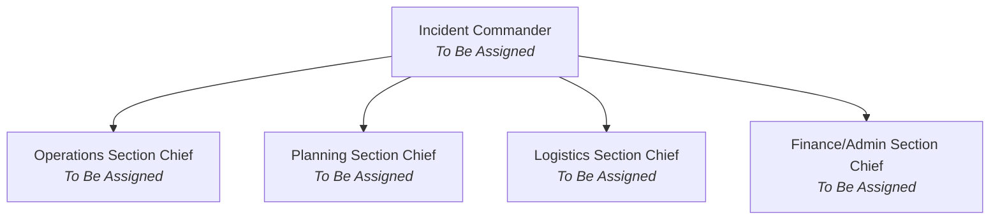

# ICS 201: Incident Briefing

| Field | Value |
| --- | --- |
| 1. Incident Name | {{ incident.name }} |
| Incident Number | {{ incident.number }} |
| 3. Date/Time Initiated |  |

## 4. Map/Sketch

Area of operations, incident site, overflight results, trajectories, impacted shorelines or other graphics, with orientation.

## 5. Situation Summary and Health and Safety Briefing

Current situation and the health and safety hazards, with the mitigations to protect responders.

## 6. Prepared by

| Name | Position/Title | Signature | Date/Time |
| --- | --- | --- | --- |
| *To Be Assigned* | Incident Commander | | |

## 7. Current and Planned Objectives

-

## 8. Current and Planned Actions, Strategies, and Tactics

| Time | Actions |
| --- | --- |
|  |  |
|  |  |
|  |  |

## 9. Current Organization

| Command Staff | Name |
| --- | --- |
| Safety Officer | *To Be Assigned* |
| Public Information Officer | *To Be Assigned* |
| Liaison Officer | *To Be Assigned* |

## 10. Resource Summary

| Resource | Resource Identifier | Date/Time Ordered | ETA | Arrived | Notes (location/assignment/status) |
| --- | --- | --- | --- | --- | --- |
|  |  |  |  |  |  |
|  |  |  |  |  |  |
|  |  |  |  |  |  |
