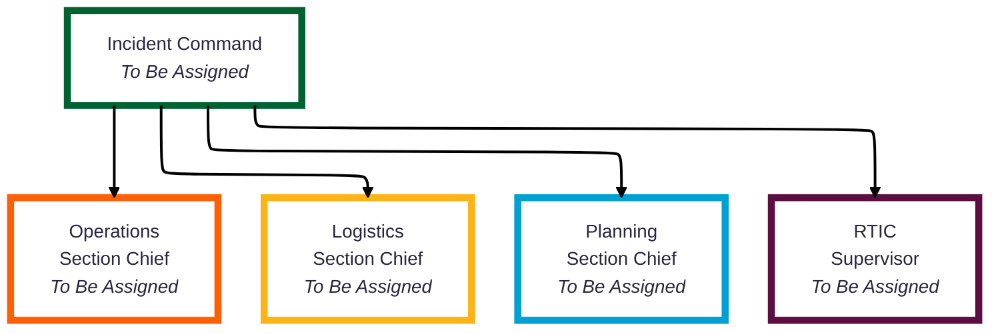

# ICS 207: Incident Organization Chart

| Field | Value |
| --- | --- |
| 1. Incident Name | {{ incident.name }} |
| Incident Number | {{ incident.number }} |
| 2. Operational Period | {{ operational_period.start }} to {{ operational_period.end }} |

## 3. Organization Chart

## 4. Prepared by

| Name | Position/Title | Signature | Date/Time |
| --- | --- | --- | --- |
| *To Be Assigned* | Resources Unit Leader | | |
