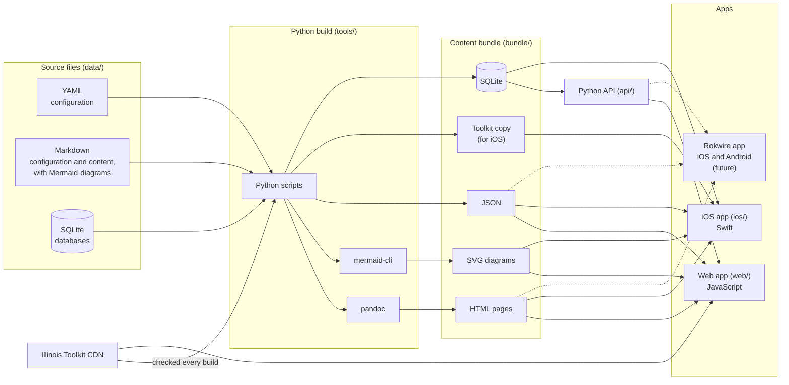

# EMMA tech stack

How EMMA's configuration and data are stored, converted and used by each app. The decisions behind these choices are in the top-level `README.md`.

## Overview

Solid lines exist or are planned now. Dashed lines are the future Rokwire app.

## Source files

Everything EMMA knows is kept in three kinds of files under `data/`, all in Git.

| Format | Folder | Holds |
| --- | --- | --- |
| YAML | `data/yaml/` | Configuration and structured content: settings, lists, the structure of the app's sections |
| Markdown | `data/md/` | Configuration written as documents, and the content itself: plans, procedures, reference pages. Diagrams are written in Mermaid inside the Markdown |
| SQLite | `data/sqlite/` | Records: data with many rows that is searched, filtered or updated |

Each YAML file has a JSON Schema in `data/schema/`. The build checks every YAML file against its schema, and the Python, JavaScript and Swift types are generated from the same schemas, so field names are the same in every language.

## Conversion: Python

The scripts in `tools/` turn the source files into the content bundle in `bundle/`, which every app uses. No app reads the source files directly.

| From | To | With |
| --- | --- | --- |
| Markdown | HTML pages built with the Illinois Web Components Toolkit | pandoc, run by Python, with a page template that loads the toolkit |
| Mermaid diagrams in Markdown | SVG images, linked from the HTML | mermaid-cli (Node.js), run by Python. The only non-Python step |
| YAML | JSON, checked against `data/schema/` | Python |
| SQLite | SQLite, created and updated | Python |

Every HTML page uses the Illinois Web Components Toolkit (v3): it loads `toolkit.css` and `toolkit.js` from `cdn.toolkit.illinois.edu/3/`, and uses toolkit components for layout and styling. See https://builder3.toolkit.illinois.edu/getting_started/index.html.

| | Web app | iOS app |
| --- | --- | --- |
| Toolkit files | From the CDN (`cdn.toolkit.illinois.edu/3/`) | Downloaded copy in `bundle/toolkit/`, refreshed by every build |
| Version | Latest v3 | Latest v3, as of the last build |
| Campus header and footer | Yes, from `cdn.brand.illinois.edu` | No |

Every build checks the toolkit's files on the CDN, including everything they load (the campus stylesheet, fonts and further scripts), and downloads any that have changed, so the iOS copy is always the current release. If the CDN can't be reached, the build warns and keeps the existing copy.

Diagrams are rendered once, at build time, so they appear instantly, look the same in every app and work offline on iOS.

## Apps

### Web app (JavaScript)

- Plain HTML, CSS and JavaScript in `web/`, with no build step, built with the Illinois Web Components Toolkit loaded from its CDN, with the campus header and footer.
- Online only: no offline mode.
- Shows the bundle's HTML pages and SVG diagrams, and reads the bundle's JSON.
- Reads and updates records through the Python API in `api/`, which uses the SQLite databases. The browser never opens a database itself.

### iOS app (Swift)

- Written in Swift, as much as possible, in `ios/`.
- SwiftUI for everything interactive: alerts, check-ins, forms, maps and notifications.
- Shows the bundle's HTML pages and SVG diagrams in a `WKWebView`, so documents look the same as on the web. Pages load the toolkit from `bundle/toolkit/` so they work offline, and have no campus header or footer.
- Reads the bundle's JSON with `Codable`.
- Keeps the SQLite databases on the device and reads them with GRDB.swift, so it works offline during an outage.

### Rokwire app (future: iOS and Android)

- EMMA's features may later be offered through Rokwire, the University of Illinois's open source mobile platform behind the Illinois app, which covers both iOS and Android.
- Rokwire apps are written in Flutter (Dart), not Swift, so this would be a separate app or module, not the Swift app.
- It would use the same Python API and the same content bundle (HTML, SVG and JSON), so no data or content changes would be needed.

## Python API

- Python, in `api/` (FastAPI proposed).
- The only way the web app, and later the Rokwire app, reads and updates records in the SQLite databases.
